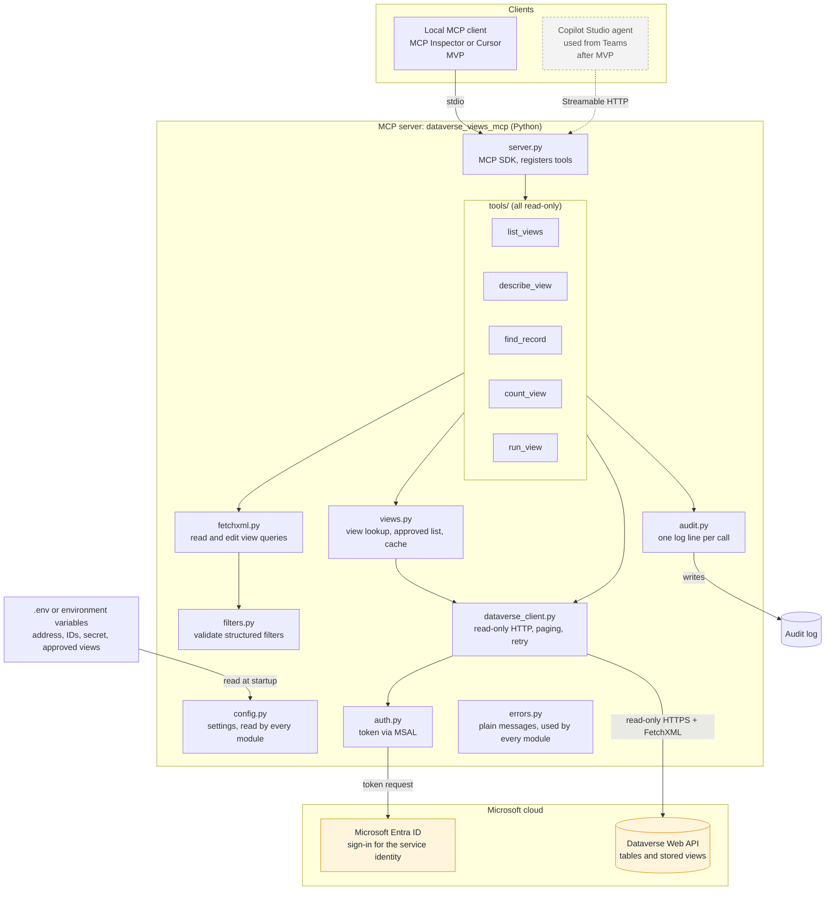
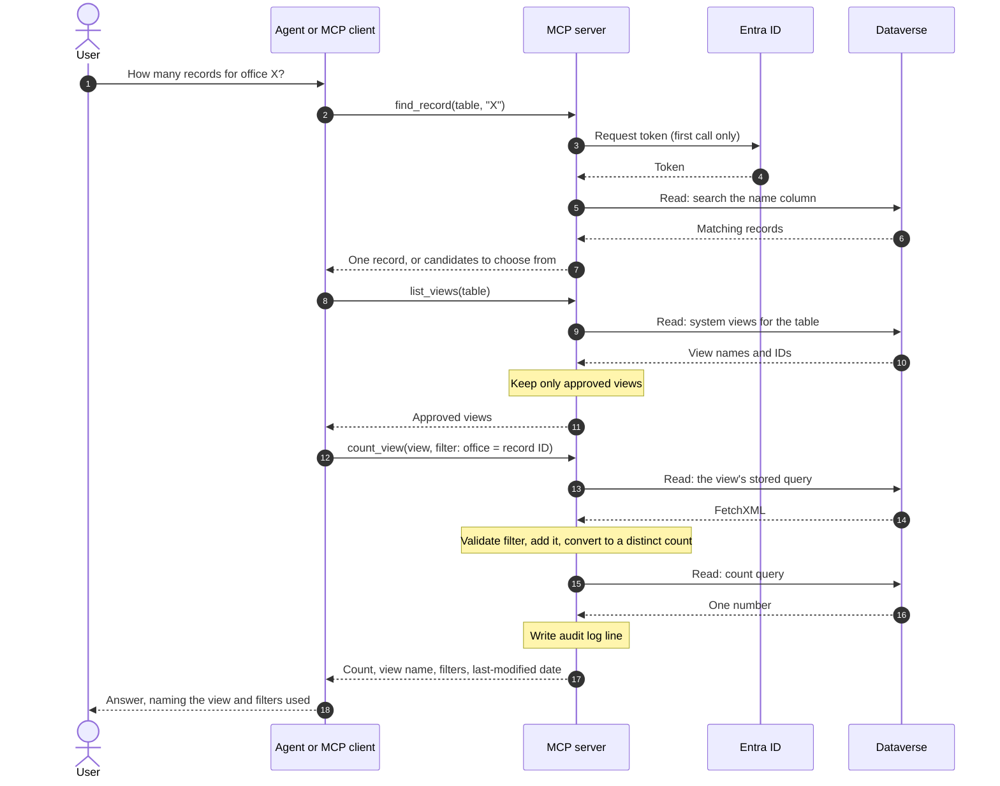
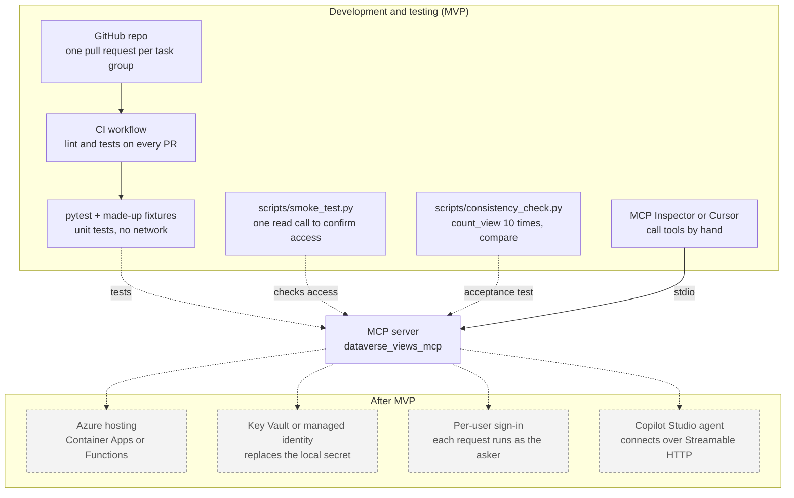

# Architecture: Dataverse Views MCP Server (MVP)

Dashed boxes and dashed lines mark things that come after the MVP.

## 1. Codebase and connections

## 2. Client and server interaction

## 3. Tooling and what comes later

